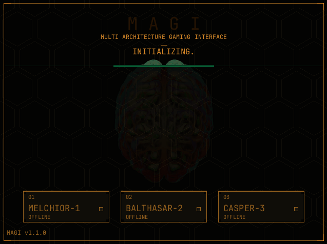

<p align="center">
  
</p>

<p align="center"><b>MULTI ARCHITECTURE GAMING INTERFACE</b></p>
<p align="center"><i>Frontend genesis for BaseOS.</i></p>

<p align="center">
  <a href="https://github.com/otacoo/magi/releases"></a>&nbsp;
  <a href="https://github.com/otacoo/magi/releases"></a>
  <br/>
  <a href="https://github.com/otacoo/magi/actions/workflows/build.yml"></a>&nbsp;
  <a href="LICENSE.md"></a>&nbsp;
  
</p>

---

**MAGI** is a fast, lightweight frontend for [BaseOS](https://github.com/pvaibhav/BaseOS) on the Anbernic H700 family.

<p align="center">
  
</p>

## Status 

> [!NOTE] 
> **v1.1.0** is stable and targets BaseOS 1.5.x. All the same devices as baseOS should be supported.\
> Netplay (beta) and devices other than 35XXSP are still untested.


## Plugging in

### You need

- An **Anbernic H700 handheld**: RG35XXSP, RG34XXSP, RG SP etc.
- A FAT32 SD card flashed with [**BaseOS**](https://github.com/pvaibhav/BaseOS).

MAGI does not ship ROMs, BIOS files, game data or any N64 ports.

### Install

1. Download the **MAGI payload for your device** from the [Releases page](https://github.com/otacoo/magi/releases):

| Screen  | Payload                                 |
|---------|-----------------------------------------|
| 640x480 | `magi-payload-640-<version>.zip`        |
| 720x480 | `magi-payload-720-<version>.zip`        |

2. Extract it and copy **the contents** to the root of the card. Do not copy the enclosing folder.
3. Put *unzipped* games in their matching `Games/<CONSOLE>/` folder.
4. Add any BIOS files to `BIOS/`.
5. Boot the console.

Updating MAGI does not overwrite `Config/`, `Saves/` or `Games/`.

### Card Layout

```text
System/frontend           the MAGI binary
System/magi/systems.json  systems supported by MAGI
System/magi/cores/        aarch64 libretro cores
System/magi/n64/          SDL 1.2 and the N64 shims
Games/<CONSOLE>/          your games
Config/                   user settings, radio state, core options
BIOS/                     console BIOS files
Overlays/                 CRT and bezel PNGs
Covers/<CONSOLE>/         optional cover art, named after the ROM
Saves/                    battery saves and save states
Screenshots/              screenshots taken with SELECT+MENU+R1
Logs/                     one capped log per process
Themes/                   user colour themes
```

MAGI will recreate missing folders at boot.

## MAGI System

```text
                                 ┌─────────────┐
                                 │   GEHIRN    │
                                 │  the brain  │
                                 └──────┬──────┘
                                        │
               ┌────────────────────────┼────────────────────────┐
               │                        │                        │
               ▼                        ▼                        ▼
   ┌──────────────────────┐ ┌──────────────────────┐ ┌──────────────────────┐
   │      MELCHIOR-1      │ │     BALTHASAR-2      │ │       CASPER-3       │
   │      the shelf       │ │       the host       │ │      the ports       │
   ├──────────────────────┤ ├──────────────────────┤ ├──────────────────────┤
   │ Shelf                │ │ Play                 │ │ N64                  │
   │ Connectivity         │ │ Display              │ │ Audio                │
   │ Power                │ │                      │ │                      │
   └──────────────────────┘ └──────────────────────┘ └──────────────────────┘
```

## System Specs

**GEHIRN · shared — One binary:** SDL2 and the font are linked in. The complete frontend is `System/frontend` on the card.


| **MELCHIOR-1** | **BALTHASAR-2** | **CASPER-3** |
|---|---|---|
| **Shelf**<br>Simple (text) or Art (cover preview) lists, art downloads, favorites, resume, per-system overlays, themes, clock and battery. | **Play**<br>Save states, resume, rewind, fast-forward, integer scaling, screenshots and an in-game OSD. | **N64**<br>[Miyoo64 native ports](assets/docs/n64-ports.md) with automatic discovery, save states, brightness/warmth OSD and a performance governor. |
| **Connectivity**<br>Wi-Fi, Bluetooth gamepads, SSH, NTP and an on-device hostname editor. | **Display**<br>EGL/GLES on the Mali GPU: hardware scaling, game shaders, bezel/CRT compositing, warmth and the in-game overlays, with a software `/dev/fb0` fallback. | **Audio**<br>Software volume, speaker/headphones/HDMI, Bluetooth A2DP and N64 audio through a small ALSA bridge. |
| **Power**<br>Lid sleep and wake, timed shutdown, battery shutdown, charge limit, LED control and the EVA shutdown countdown. | | |


## Instruction Manuals

| Guide | What it covers |
|---|---|
| [Box art](assets/docs/box-art.md) | Covers, the ART interface and downloads. |
| [Card tool](https://otacoo.github.io/magi/card_tool.html) | Browser cover checks, libretro art search and card file management. |
| [Themes](assets/docs/themes.md) | NERV, UNIT-01, UNIT-02 and user `.ini` themes. |
| [Multi-disc PlayStation](assets/docs/multi-disc.md) | `.m3u` playlists and disc swap. |
| [Netplay](assets/docs/netplay.md) | Game Boy link play over hotspot or Wi-Fi. |
| [Controls](assets/docs/controls.md) | Every button, on the shelf and in game. |
| [SD card repair](assets/docs/storage.md) | What happens when the card turns read-only. |
| [Cores](assets/docs/cores.md) | Bundled cores and the BIOS files they need. |
| [Miyoo64 ports](assets/docs/n64-ports.md) | Installing native N64 ports. |
| [Building MAGI](assets/docs/building.md) | Instructions on how to birth the frontend. |

## License

MAGI is released under the **BSD 2-Clause License**. See [LICENSE.md](LICENSE.md).

Bundled assets and libraries keep their own licenses: JetBrains Mono (OFL), GEHIRN boot art (CC BY-SA 4.0), Perfect Overlays, the SDL controller database and SDL 1.2/2 (zlib). Full attributions are in [NOTICE.md](NOTICE.md). libretro cores and N64 ports are separate components with their own licenses.

## Credits

- The geniuses at Gainax / Khara, by which MAGI is inspired.
- [BaseOS](https://github.com/pvaibhav/BaseOS) for the H700 platform.
- [libretro](https://www.libretro.com/) and every core maintainer.
- [SDL](https://www.libsdl.org/) and the SDL Game Controller DB community.
- [JetBrains Mono](https://www.jetbrains.com/lp/mono/) by JetBrains.
- ["the human brain"](https://www.neurobureau.org/abstract_the-human-brain_by_crean-quaner/) by Crean Quaner, The Neuro Bureau (CC BY-SA 4.0).
- [Perfect Overlays](https://github.com/ourigen/Perfect_Overlays) by ourigen, 1playerinsertcoin, mugwomp_93 and drkhrse.

<p align="center"><sub><i>Â̶̢̧͚͎̺͎̮̩̮̝̳̼̟͖͑̈͆̈́̍̕͝L̶̢̡̥̲̹̙̣͖͎̩̰̣̜͌̓́̂̽̒̽͗͐̕͠Ļ̷̹͕̻͖͚̪̩̖͍͋͋̐̉̃͆̍̽̅̅́́͆̕̚ ̸̡̊́̋́͆̊̊̔S̸͔̀̾́̍͌͠͝YSTEMS N̵̩͓̎͑͗́͘O̵͓͉̪̪̜͒͒ͅḾ̴͖̩̰͈̫̊̚͜͠Ḭ̵̡͆͆͂̔͠N̵͕̮̠͚̼̄͊̄̀AL.</i></sub></p>
<br>
<p align="right">
<sub><i>
Enjoy this frontend? Buy me a <a href="https://ko-fi.com/otacoo">cawfee</a> ☕~
</i></sub>
<br>
</p>
