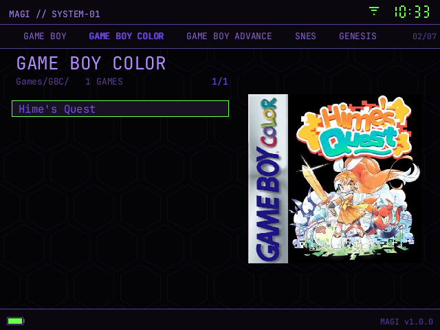

# Box art

The **ART** shelf shows a cover beside the game list. Covers live under
`Covers/` on the card; copy them in by hand or let MAGI download the missing
ones from
[libretro-thumbnails](https://github.com/libretro-thumbnails/libretro-thumbnails)
while the card's Wi-Fi is up.



## Files on the card

```text
Covers/<FOLDER>/<name>.png         boxart
Covers/<FOLDER>/<name>.snap.png    snap
Covers/<FOLDER>/<name>.title.png   title
Covers/<FOLDER>/<name>.logo.png    logo
```

`<FOLDER>` is the system's `folder` value from `systems.json`; it defaults to
the upper-cased system id. It is not the display name.

`<name>` is the game's cover stem:

- a ROM directly in `Games/<FOLDER>/` uses its own file stem:
  `Tetris (World).gb` → `Tetris (World)`;
- a game in a sub-folder uses that first sub-folder's name:
  `Games/PS1/Game/disc.cue` → `Game`;
- a native N64 port uses the port folder:
  `Games/N64/<title>/rom.z64` → `<title>`.

This is the exact path MAGI builds. There is no fuzzy fallback, no alternate
extension and no recursive cover search. FAT32 is case-insensitive, so an
existing `covers/ps1/...` still matches; MAGI writes the canonical case. A
`.png` that fails to decode is treated as missing.

## Art types

`ART TYPE` selects the file shown in the panel. `ALL` tries boxart, snap,
title and logo in that order and shows the first valid file. For one system,
**Y → CORE → CORE ART** overrides the global art type.

## How a download is matched

MAGI first asks libretro-thumbnails for the ROM's own stem. If that misses, it
resolves the dump through the system's DAT — CRC-32 for cartridge dumps, dump
name for disc images; a multi-disc `.m3u` uses its first disc — and asks for
the DAT name instead.

If neither exact name has art, MAGI falls back to DAT entries with the same
title ignoring region/revision tags. It prefers a stable dump, then the same
region, then the same disc number; up to six candidates are tried. This is how
patched, translated or renamed ROMs still get a cover.

A 404 or a file that is not a valid PNG is a miss. A connection failure aborts
the job and reports `ART: OFFLINE`. Existing files are never replaced, and
every card write is atomic. The downloaded file is still saved under the cover
stem above, so the local lookup never depends on the DAT name.

## Settings

Everything lives under **SETTINGS → SHELF**:

| Row | Effect |
|---|---|
| **INTERFACE** | SIMPLE (text rows) or ART (cover panel). |
| **AUTO ART** | Fetch missing covers when a system is opened in ART with Wi-Fi up. Off leaves the card untouched. |
| **ART TYPE** | Boxart, snap, title, logo or ALL. ALL downloads all four and the panel shows the first that exists, boxart first. |
| **ART BACKGROUND** | NONE floats the cover on a drop shadow; CARD keeps the bordered plate. |
| **DOWNLOAD ART** | Fetch the current system now. Progress and the spinner appear in the bottom bar; **B** stops it. |

## Card tool

Download or open [`card_tool.html`](https://otacoo.github.io/magi/card_tool.html) in Chrome or Edge (*) and
select the card root. The card tool reads `Games/` and `Covers/` locally and reports:

- games with no boxart, or with no art at all;
- invalid PNGs, duplicate names and shared cover stems;
- files in `Covers/` that no game matches (orphans, nested folders, non-PNG);
- non-ASCII file names, which can stop Firefox's folder picker.

Select a game, choose BOXART/SNAP/TITLE/LOGO, then add, replace or drop an
image. JPG, WebP, GIF and BMP are converted to PNG in the browser before the
write. Covers, including orphans, can be renamed in place; a ROM can also be
renamed from NON-ASCII after accepting that its save and cover stem change.
With the directory picker the tool writes directly to the card; without
it the tool scans read-only and downloads the correctly named PNG to copy over.
Firefox and other browsers without the directory API give the page a read-only
copy; use Chrome or Edge for direct writes. Firefox's folder input can return
nothing when the card has hidden system folders or non-ASCII file names; rename
those files, or use Chrome/Edge.

**LIBRETRO SEARCH** searches the selected system's libretro-thumbnails
collection by name or region and fetches the chosen boxart, snap, title or
logo. It saves under the local ROM stem, so a renamed or region-mismatched ROM
can still get the right art. This is the only network feature; the names are
cached in memory and nothing is uploaded.

**MATCH CRC** reads the selected ROM, computes its CRC-32 and looks the dump up
in the system's DAT. A SNES copier header is handled by testing both sides of
the 512-byte boundary. Disc systems use the DAT dump name instead (for a
`.m3u`, the first disc). The matched canonical name fills the search box, so
the right art can be chosen without guessing.

The selected game’s **DELETE ROM** removes the ROM file only; covers, saves and
states are left on the card.

* If the picker is blocked when the page is opened as a file, serve the repo
locally (`python -m http.server 8000`) and open
`http://localhost:8000/card_tool.html`. Nothing is uploaded.