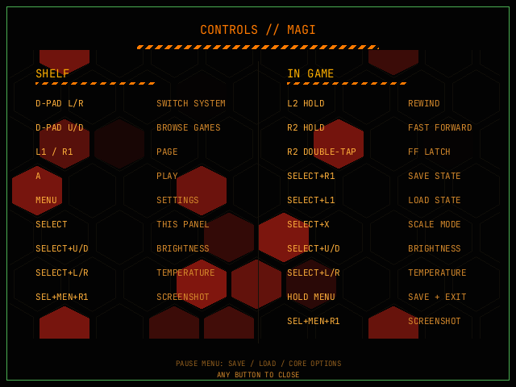

# Controls

The **SELECT** panel on the shelf lists the same shortcuts; this page is the
reference.

| Where | Input | Action |
|---|---|---|
| Shelf | D-pad ←/→ | Switch system |
| Shelf | **L2 / R2** | Switch system |
| Shelf | D-pad ↑/↓ | Browse games |
| Shelf | L1 / R1 | Page |
| Shelf | **A** | Play |
| Shelf | **X** | Game menu: info, play time, rename, delete or art type |
| Shelf | **Y** | Favorite (star) |
| Shelf | **MENU** | Settings |
| Shelf | **SELECT** | Controls panel |
| Shelf | **POWER** tap / hold | Sleep / shutdown |
| Shelf | SETTINGS → SYSTEM → **SCREENSHOTS** | Browse captures; **A** zooms, **Y** twice deletes (shown while the shot chord is on) |
| In game | **MENU** | Pause menu |
| In game | Pause menu ↑/↓ | Pick a tab |
| In game | Pause menu ←/→ | Slot, disc or option value |
| In game | Pause menu **A** | Resume, save/load, exit or adjust |
| In game | Pause menu **B** | Resume |
| In game | Pause menu **Y** | Delete the shown state (press Y twice) |
| In game | Hold **MENU** | Save state and exit |
| In game | **L2** hold | Rewind (except N64 and PS1) |
| In game | **R2** hold / double-tap | Fast-forward / latch (except N64; PS1 requires holding SELECT) |
| In game | **SELECT+R1 / SELECT+L1** | Save state / load state |
| In game | **SELECT+X** | Scale: fit / integer / stretch |
| In game | **SELECT+↑/↓** | Brightness |
| In game | **SELECT+←/→** | Warmth (blue-light reduction) |
| In game | **POWER** tap / hold | Sleep / shutdown |
| Anywhere | **SELECT+MENU+R1** | Screenshot (disabled by default in SETTINGS → SYSTEM) |
| Anywhere | Volume keys | Software volume |
| Anywhere | Close the lid | Sleep; opening wakes |

**X** opens the game menu with **INFO**, **GAME**, **SYSTEM** and **CLOSE** tabs;
**L1/R1** switch tabs, **↑/↓** picks a row and **B** or **X** closes. **GAME → TRACK
PLAY TIME** accumulates this game's play time; the total appears in **INFO**
as hours:minutes:seconds. **SYSTEM → SWAP A/B** swaps the emulated A and B
buttons for every game on that system; the frontend's own A/B stay the same.

**SAVE STATE** and **LOAD STATE** act on the slot shown in the pane: **A**
saves or loads it, **←/→** switches slots and **Y** twice deletes it. **CORE**
shows its options in the pane; **A** or **→** enters the list, **↑/↓** picks an
option and **←/→** changes its value. **VIDEO** opens the overlay options with
**A**; **NETPLAY** opens the link flow. The one-shot resume state loads at
launch and is then consumed; hold **A** when a game starts to skip that restore
without deleting it. **SELECT+R1** quick saves and hold **MENU** both write the
selected slot and a resume point.

On a multi-disc PlayStation game the pause menu also gains a **DISC** tab;
**←/→** picks the image and **A** swaps it. See
[Multi-disc PlayStation](multi-disc.md).
