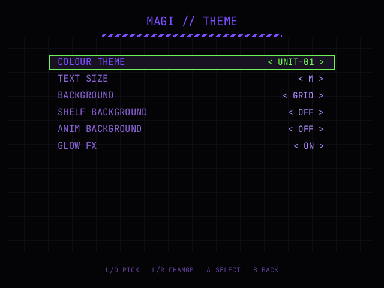

# Themes

MAGI ships two colour themes:

- **NERV** — orange on black, the classic MAGI look (the default).
- **UNIT-01** — purple chassis with unit-green signals.

Pick one under **SETTINGS → THEME → COLOUR THEME**.



The same choice is used by the shelf, the in-game pause menu and the N64 OSD,
and it is stored as `theme` in `Config/magi.json`.

## User themes

`Themes/` on the card holds your own themes. Copy `Themes/_template.ini` to a
new name ending in `.ini`, edit the colours and reboot:

- MAGI creates `Themes/` and the template at start-up.
- Files load after NERV and UNIT-01, in file-name order, up to eight.
- Names starting with `_` are skipped, so the template never loads itself.
- A missing key keeps the NERV colour; unknown keys and invalid values are
  ignored, so a theme cannot break the frontend.

The file is a flat `key = value` list. Colours are `RRGGBB` or `RGB` (a
leading `#` is optional); `heat` takes five comma-separated colours. Inline
`#` and `;` comments are allowed.

```ini
name = MY UNIT
bg0 = 030303
accent = ff2a2a
text = f2f2f2
glow = ff2a2a
heat = 2a5cff, 00c896, 7ad63a, ffb000, ff2a1a
```

## Keys

| Key | What it paints |
|---|---|
| `bg0`–`bg3` | Surfaces, darkest first. |
| `title` | Page, panel and shelf titles. |
| `text` | Body text, values and status messages. |
| `text_dim` | Secondary rows and labels. |
| `text_faint` | Hints, captions and disabled text. |
| `accent` | Selection text, active tab, ratios and hazard bars. |
| `border` | Static frame and divider lines. |
| `glow` | The breathing glow on borders and the selected row. |
| `alert` | Errors, warnings and low-battery state. |
| `clock` | The seven-segment clock and the clock wizard. |
| `battery` | A healthy battery fill and its percentage. |
| `battery_shell` | The battery case outline and terminal. |
| `scrollbar` | Scrollbar thumb. |
| `scrollbar_track` | Scrollbar track. |
| `signal` | "On" states: Wi-Fi, favorite star, spinner, connected rows. |
| `link` | The Bluetooth/radio icon. |
| `heat` | Volume/brightness/temperature bar ramp (five colours). |
